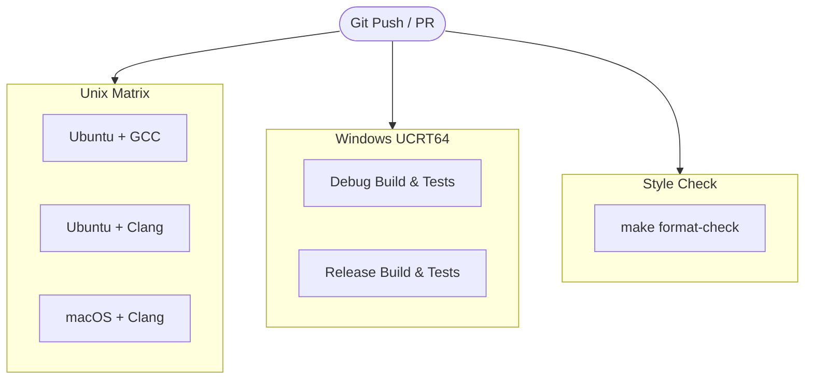

# `.github/` — Continuous Integration (CI) Automation

This directory contains GitHub Actions workflows that automatically build, test, analyze, and format-check the project across all major operating systems on every commit and pull request.

---

## Workflow Overview: `ci.yml`

The CI workflow is defined in [`.github/workflows/ci.yml`](workflows/ci.yml) and triggers on:
- Every `push` to any branch
- Every `pull_request` targeting any branch
- Manual execution via `workflow_dispatch`

It consists of three parallel jobs:



---

## Job Details

### 1. `unix` (Ubuntu & macOS Matrix)
Runs on `ubuntu-latest` and `macos-latest` across compilers:
- **Matrix Combinations**:
  - `ubuntu-latest` with `gcc`
  - `ubuntu-latest` with `clang`
  - `macos-latest` with `clang` *(macOS GCC is excluded because Apple aliases GCC to Clang)*
- **Execution Steps**:
  1. **Debug Build**: `make CC=<cc> WERROR=1` ensures the project builds without warnings.
  2. **Unit Tests (Debug)**: `make test CC=<cc> WERROR=1` runs all test suites in `tests/`.
  3. **Address & Undefined Behavior Sanitizers (Linux)**:
     ```bash
     make test CC=<cc> WERROR=1 SANITIZE=address,undefined BUILD_DIR=build-asan
     ```
     Runs tests under AddressSanitizer (ASan) and UndefinedBehaviorSanitizer (UBSan) in an isolated build directory (`build-asan/`) to detect buffer overflows, memory leaks, and undefined operations.
  4. **Release Build & Tests**: `make release test CC=<cc> WERROR=1` verifies optimization `-O2` builds and tests.

---

### 2. `windows` (MSYS2 UCRT64)
Runs on `windows-latest` using the modern MSYS2 UCRT64 runtime:
- Sets up MSYS2 via `msys2/setup-msys2@v2` with `mingw-w64-ucrt-x86_64-gcc` and `mingw-w64-ucrt-x86_64-make`.
- Executes commands directly inside the MSYS2 bash environment:
  1. `mingw32-make WERROR=1`
  2. `mingw32-make test WERROR=1`
  3. `mingw32-make release test WERROR=1`

---

### 3. `format` (Clang-Format Style Enforcement)
Runs on `ubuntu-latest`:
- Executes `make format-check`.
- Invokes `clang-format --dry-run --Werror` on all `.c` and `.h` files in `src/`, `include/`, and `tests/`.
- Fails the build if any committed file does not conform to the root `.clang-format` rules.

---

## How to Reproduce CI Steps Locally

Before pushing changes to GitHub, you can run the exact same checks locally:

```bash
# 1. Compile with warnings treated as errors
make WERROR=1

# 2. Run unit tests
make test WERROR=1

# 3. Test release build
make release test WERROR=1

# 4. Run Address & Undefined Sanitizers (Linux/macOS)
make test SANITIZE=address,undefined

# 5. Check formatting compliance
make format-check

# 6. Apply formatting fixes automatically if format-check failed
make format
```
