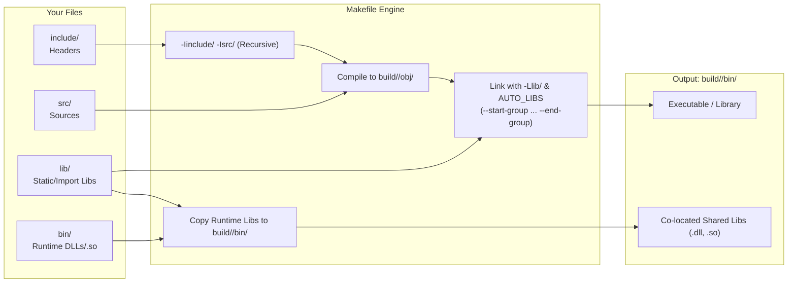

# Modern C Project Template

A professional, cross-platform, zero-friction C project template designed for real-world applications and libraries.

Compiles out of the box on **Windows** (MSYS2 UCRT64, native `cmd.exe`, PowerShell, Git Bash), **Linux**, and **macOS** using **GNU Make**, **GCC** or **Clang**, **clangd**, **GDB/LLDB**, and **VS Code**.

---

## Table of Contents

1. [Key Features](#key-features)
2. [Project Structure](#project-structure)
3. [Prerequisites & Toolchain Setup](#prerequisites--toolchain-setup)
4. [Quick Start](#quick-start)
5. [Configuration Guide (`config.mk`)](#configuration-guide-configmk)
6. [Drop-In Dependency Architecture](#drop-in-dependency-architecture)
7. [Target Types: Applications & Libraries](#target-types-applications--libraries)
8. [Unit Testing System](#unit-testing-system)
9. [Code Quality & Tooling](#code-quality--tooling)
10. [Visual Studio Code Integration](#visual-studio-code-integration)
11. [Continuous Integration (GitHub Actions)](#continuous-integration-github-actions)
12. [Make Targets Reference](#make-targets-reference)
13. [Troubleshooting & FAQ](#troubleshooting--faq)
14. [License](#license)

---

## Key Features

- **Zero-Friction Drop-In Architecture (`include/`, `lib/`, `bin/`)**:
  Drop headers into `include/`, static/import libraries into `lib/`, and runtime shared libraries (`.dll`, `.so`, `.dylib`) into `bin/`. The build system recursively scans, compiles, links, and deploys them alongside your binaries automatically.
- **Single Configuration Point (`config.mk`)**:
  All project settings (binary name, project type, C standard, warnings, optimization, compiler) live in `config.mk`. The generic `Makefile` contains the portable build engine and never needs editing.
- **Three Target Types**:
  Switch between `executable`, `static` library (`lib<name>.a`), or `shared` library (`.dll` / `.so` / `.dylib`) by changing a single variable in `config.mk`.
- **Dual Build Modes**:
  Clean separation of debug (`build/debug/`) and release (`build/release/`) artifacts.
- **Header Dependency Tracking**:
  Incremental compilation automatically tracks header modifications using compiler-generated dependency files (`.d`).
- **Dynamic `compile_commands.json` Generation**:
  Accurate compilation database generated directly from Makefile flags on every build, giving **clangd** and **clang-tidy** perfect code intelligence with zero configuration drift.
- **Parallel Builds by Default**:
  Automatically calculates hardware CPU cores (`-jN`) on GNU Make >= 4.0.
- **Cross-Shell & Cross-Platform Abstraction**:
  Seamlessly adapts recipes and path separators for native Windows `cmd.exe` as well as POSIX shells (`sh`, `bash`).
- **Built-in Modular Unit Testing (`make test`)**:
  Each `tests/test_*.c` suite compiles into an isolated executable, linked with project modules (excluding `main.c`) and evaluated via a minimal, zero-dependency testing header (`tests/test_framework.h`).
- **Sanitizer Support**:
  One-command Address and Undefined Behavior Sanitizers via `make SANITIZE=address,undefined`.
- **First-Class Code Quality Tools**:
  Ready-to-use **Clang-Format** (`make format`, `make format-check`) and **Clang-Tidy** (`make tidy`).
- **Turnkey VS Code Integration**:
  Pre-configured tasks (`tasks.json`), F5 debugging with GDB/LLDB pretty-printing (`launch.json`), and clangd language intelligence (`settings.json`).
- **Comprehensive CI Matrix**:
  Multi-platform GitHub Actions workflow covering Linux (GCC & Clang), macOS (Clang), Windows (MSYS2 UCRT64), Sanitizers, and formatting checks.

---

## Project Structure

Each directory contains a dedicated `README.md` detailing its conventions, discovery rules, and best practices:

```text
.
├── config.mk                 # Project identity, flags, and build configuration (user-editable)
├── Makefile                  # Portable build engine (POSIX sh & Windows cmd.exe — do not edit)
├── compile_commands.json     # Clang compilation database (auto-generated by make)
├── .clang-format             # Code formatting rules (exhaustive options documented)
├── .clang-tidy               # Static analysis rules tailored for modern C
├── .gitattributes            # Line endings and binary file handling
├── .gitignore                # Ignores build outputs, caches, and system files
├── LICENSE                   # MIT License
│
├── src/                      # [README] C source files (recursively discovered and compiled)
│   ├── main.c                # Application entry point (excluded during test & library builds)
│   ├── greeting.c            # Example module implementation
│   └── README.md             # Guide: source organization, main exclusion, internal headers
│
├── include/                  # [README] Public and third-party interface headers
│   ├── greeting.h            # Example public module interface
│   └── README.md             # Guide: header inclusion, API contracts, header-only libs
│
├── lib/                      # [README] Drop-in static & import libraries (.a, .lib, .dll.a, .so, .dylib)
│   └── README.md             # Guide: auto-linking, smart selection, order-independent linking
│
├── bin/                      # [README] Drop-in runtime dynamic libraries (.dll, .so, .dylib)
│   └── README.md             # Guide: automatic deployment to build/bin, rpath handling
│
├── tests/                    # [README] Standalone unit test suites
│   ├── test_framework.h      # Minimal, dependency-free test assertion macros
│   ├── test_greeting.c       # Example test suite
│   └── README.md             # Guide: writing tests, running suites, custom frameworks
│
├── build/                    # Generated automatically during compilation (ignored by git)
│   ├── debug/                # Debug artifacts (-g3 -O0 -DDEBUG)
│   │   ├── bin/              # Executables, test runners, and copied runtime DLLs
│   │   └── obj/              # Object (.o) and dependency (.d) files
│   └── release/              # Release artifacts (-O2 -DNDEBUG -s)
│       ├── bin/
│       └── obj/
│
├── .vscode/                  # [README] Turnkey Visual Studio Code configuration
│   ├── extensions.json       # Recommended extensions (clangd, cpptools, makefile-tools)
│   ├── launch.json           # F5 debug launcher (GDB/LLDB, integrated & external console)
│   ├── settings.json         # clangd language server, format-on-save, search exclusions
│   ├── tasks.json            # Build, test, clean, format, tidy, and auto-configure tasks
│   └── README.md             # Guide: VS Code tasks, debugging profiles, MSYS2 PATH injection
│
└── .github/                  # GitHub Actions configuration
    └── workflows/            # [README] Multi-OS matrix CI
        ├── ci.yml            # Workflow definition (Linux, macOS, Windows UCRT64, ASan/UBSan)
        └── README.md         # Guide: CI matrix, reproducible local checks, pull request gate
```

---

## Prerequisites & Toolchain Setup

### Windows (MSYS2 UCRT64 — Recommended)

1. Download and install [MSYS2](https://www.msys2.org/).
2. Open the **MSYS2 UCRT64** terminal and install the required tools:
   ```bash
   pacman -S --needed \
       mingw-w64-ucrt-x86_64-gcc \
       mingw-w64-ucrt-x86_64-gdb \
       mingw-w64-ucrt-x86_64-make \
       mingw-w64-ucrt-x86_64-clang \
       mingw-w64-ucrt-x86_64-clang-tools-extra
   ```
3. Add `C:\msys64\ucrt64\bin` and `C:\msys64\usr\bin` to your Windows `PATH` environment variable.
4. On Windows command prompts, you can invoke `mingw32-make` directly (or alias `make` to `mingw32-make`).

### Linux (Debian / Ubuntu / Raspberry Pi OS)

```bash
sudo apt update
sudo apt install build-essential gcc gdb clangd clang-format clang-tidy
```

### Linux (Arch / Manjaro)

```bash
sudo pacman -S base-devel gcc gdb clang
```

### macOS (Homebrew)

```bash
brew install make llvm
```
*(macOS uses Clang by default; `lldb` is provided by Xcode Command Line Tools: `xcode-select --install`)*.

---

## Quick Start

Open a terminal in the project directory:

```bash
# 1. Build in debug mode (default)
make

# 2. Run the application
make run

# 3. Pass command-line arguments to the application
make run ARGS="Ada"

# 4. Build and execute all unit test suites
make test

# 5. Build in release mode (optimized -O2, stripped symbols)
make release

# 6. Build and run in release mode
make release run ARGS="World"

# 7. Check build configuration, detected libraries, and paths
make info

# 8. Clean all build outputs
make clean
```

> **Windows Note**: If `make` is not aliased, run `mingw32-make` instead. All targets, variables, and flags work identically.

---

## Configuration Guide (`config.mk`)

All project settings are centralized in [`config.mk`](config.mk). The generic [`Makefile`](Makefile) reads these variables and applies them across all recipes. Every variable uses `?=` so it can be overridden from the command line (e.g., `make CC=clang BUILD=release`).

### Configuration Variables Reference

| Variable | Default Value | Description |
|---|---|---|
| `PROJECT` | Current folder name | Output binary name. Spaces are automatically converted to underscores. Renaming the folder automatically updates the binary name and VS Code debug launcher. |
| `VERSION` | `0.1.0` | Injected into preprocessor as `PROJECT_VERSION=\"...\"`. |
| `PROJECT_TYPE` | `executable` | Target type: `executable`, `static` library (`lib<name>.a`), or `shared` library (`.dll` / `.so` / `.dylib`). |
| `BUILD` | `debug` | Default build mode: `debug` or `release`. Shortcut: `make release`. |
| `CC` | `gcc` | C compiler (`gcc`, `clang`, or cross-compilation triple). |
| `C_STANDARD` | `c17` | C language standard: `c99`, `c11`, `c17`, `c23`, `gnu17`. |
| `WARNINGS` | `-Wall -Wextra ...` | Strict compilation warning flags. |
| `WERROR` | `0` | When set to `1`, treats all warnings as fatal errors (recommended for CI). |
| `DEBUG_CFLAGS` | `-g3 -O0 -DDEBUG` | Compiler flags applied only in debug mode. |
| `RELEASE_CFLAGS` | `-O2 -DNDEBUG` | Compiler flags applied only in release mode. |
| `DEBUG_LDFLAGS` | *(empty)* | Linker flags applied in debug mode. |
| `RELEASE_LDFLAGS` | `-s` | Linker flags applied in release mode (symbol stripping; omitted on macOS). |
| `SANITIZE` | *(empty)* | Sanitizers to enable (e.g. `make SANITIZE=address,undefined`). |
| `EXTRA_CPPFLAGS` | *(empty)* | Additional preprocessor flags (e.g. `-DENABLE_FEATURE=1`). |
| `EXTRA_CFLAGS` | *(empty)* | Additional compiler flags (e.g. `-march=native`). |
| `EXTRA_LDFLAGS` | *(empty)* | Additional linker flags (e.g. `-mwindows` on Windows for GUI apps). |
| `LDLIBS` | `-lm` | System libraries linked via toolchain (e.g. `-lws2_32 -lgdi32 -lpthread`). |
| `PKG_CONFIG_PACKAGES` | *(empty)* | Space-separated package list for `pkg-config` (e.g. `sdl2 libcurl`). |
| `SRC_DIR` | `src` | Directory containing application/library source code. |
| `INC_DIR` | `include` | Directory containing public/third-party header files. |
| `LIB_DIR` | `lib` | Directory containing drop-in static and import libraries. |
| `BIN_DIR` | `bin` | Directory containing drop-in runtime shared libraries. |
| `TEST_DIR` | `tests` | Directory containing unit test suites (`test_*.c`). |
| `BUILD_DIR` | `build` | Output directory for all compiled object and binary files. |
| `AUTO_LINK` | `1` | Automatically link all libraries discovered in `lib/`. Set `0` for manual linking. |
| `AUTO_LINK_EXCLUDE`| *(empty)* | Filenames or patterns in `lib/` to exclude from auto-linking. |
| `MAIN_SRC` | `$(SRC_DIR)/main.c` | Source file containing `main()`. Excluded when building tests or libraries. |
| `COMPILE_COMMANDS` | `1` | Automatically write `compile_commands.json` on make invocations. |
| `CLANG_FORMAT` | `clang-format` | Name or path of the `clang-format` executable. |
| `CLANG_TIDY` | `clang-tidy` | Name or path of the `clang-tidy` executable. |
| `PKG_CONFIG` | `pkg-config` | Name or path of the `pkg-config` executable. |
| `ARGS` | *(empty)* | Arguments forwarded to the executable by `make run`. |

### Overriding Settings from Command Line

You can override any variable without editing files:
```bash
# Build with Clang and warnings as errors
make CC=clang WERROR=1

# Build an optimized release binary named my_tool
make release PROJECT=my_tool

# Build and run with AddressSanitizer
make test SANITIZE=address,undefined
```

---

## Drop-In Dependency Architecture

Adding third-party libraries and code requires **zero Makefile modifications**:



1. **Headers (`include/` and `src/`)**:
   - Every subdirectory in `include/` and `src/` is automatically added to the compiler's include path (`-I`).
   - All paths are recorded in `compile_commands.json` so `clangd` recognizes them immediately.
2. **Static & Import Libraries (`lib/`)**:
   - Discovers `.a`, `.lib`, `.dll.a`, `.so`, and `.dylib` files.
   - **Order-Independent**: Wrapped in `-Wl,--start-group ... -Wl,--end-group` (Windows/Linux) to prevent circular symbol issues.
   - **Smart Selection**: If both a static library (`libfoo.a`) and an import/shared library (`libfoo.dll.a` or `libfoo.so`) are found, the build system automatically selects the shared/import library.
   - **Dead Stripping**: Uses `-Wl,--as-needed` to avoid adding unreferenced shared dependencies.
3. **Runtime Shared Libraries (`bin/`)**:
   - Any `.dll`, `.so`, or `.dylib` in `bin/` (or `lib/`) is automatically copied into `build/<mode>/bin/` alongside your executable and test binaries.
   - **Origin Rpath**: On Linux (`-Wl,-rpath,'$$ORIGIN'`) and macOS (`-Wl,-rpath,@executable_path`), the binary automatically loads co-located shared libraries without modifying `LD_LIBRARY_PATH`.

---

## Target Types: Applications & Libraries

Configure `PROJECT_TYPE` in `config.mk`:

### 1. `executable` (Default)
- Compiles all `src/**/*.c` files (including `src/main.c`).
- Links against `lib/` and system libraries.
- Produces `build/<mode>/bin/<PROJECT>[.exe]`.

### 2. `static` (Static Library)
- Compiles all `src/**/*.c` files **excluding** `src/main.c` (`MAIN_SRC`).
- Uses `$(AR) rcs` to archive object files.
- Produces `build/<mode>/bin/lib<PROJECT>.a`.

### 3. `shared` (Dynamic / Shared Library)
- Compiles all `src/**/*.c` files **excluding** `src/main.c` (`MAIN_SRC`).
- Enables `-fPIC` (Position Independent Code) on Unix platforms.
- Links objects and dependencies with appropriate platform flags:
  - **Windows**: `-shared -Wl,--out-implib,build/<mode>/bin/lib<PROJECT>.dll.a` (generates both `<PROJECT>.dll` and import library).
  - **Linux**: `-shared -Wl,-soname,lib<PROJECT>.so`.
  - **macOS**: `-dynamiclib -install_name @rpath/lib<PROJECT>.dylib`.

---

## Unit Testing System

The template features a standalone, modular testing system in `tests/`:

```bash
make test
```

### Architecture
- **Suite Isolation**: Every file named `tests/test_*.c` is compiled into an isolated executable in `build/<mode>/bin/test_<name>[.exe]`.
- **Application Logic Included**: Test suites are automatically linked against all project source objects in `src/` (excluding `src/main.c`), granting direct access to your internal functions.
- **Shared Helpers**: Any helper `.c` file in `tests/` that is not named `test_*.c` is automatically compiled and linked into all test suites.
- **Runtime Access**: Test binaries run directly from `build/<mode>/bin/`, where all runtime shared libraries (`.dll`, `.so`) are already copied.

### Writing a Test Suite

Use the lightweight, zero-dependency helper [`tests/test_framework.h`](tests/test_framework.h):

```c
#include "greeting.h"
#include "test_framework.h"

static void test_greeting_custom(void) {
    char buf[64];
    greeting_format(buf, sizeof buf, "Linus");
    CHECK_EQ_STR("Hello, Linus!", buf);
}

int main(void) {
    RUN_TEST(test_greeting_custom);
    return TEST_REPORT();
}
```

### Available Assertions

- `CHECK(expression)`: Validates that `expression` evaluates to true.
- `CHECK_EQ_INT(expected, actual)`: Compares two integer values (`long long`).
- `CHECK_EQ_STR(expected, actual)`: Compares two C strings (`NULL`-safe).
- `RUN_TEST(func)`: Runs test function and logs `PASS` / `FAIL`.
- `TEST_REPORT()`: Summarizes passes/failures and returns exit code `0` or `1`.

---

## Code Quality & Tooling

### Clang-Format (`make format` / `make format-check`)

Format all project sources and headers according to [`.clang-format`](.clang-format):
```bash
make format
```

Check code formatting without modifying files (used in CI):
```bash
make format-check
```

### Clang-Tidy (`make tidy`)

Run in-depth static analysis across all project sources using [`.clang-tidy`](.clang-tidy):
```bash
make tidy
```

### Automatic `compile_commands.json`

Every time `make` is invoked, it writes an exact compilation database (`compile_commands.json`) containing the exact compiler flags, macros, and include paths for every source file.
- **clangd** uses this file for instantaneous, precise code intelligence, jump-to-definition, and refactoring.
- **clang-tidy** uses this file to resolve includes and language dialects during analysis.

---

## Visual Studio Code Integration

Open the workspace folder in VS Code (`code .`):

- **IntelliSense**: Powered by the recommended **clangd** extension via `compile_commands.json`.
- **Keyboard Shortcuts**:
  - `Ctrl + Shift + B`: Run default build task.
  - `F5`: Build and launch with GDB / LLDB debugger.
  - `Ctrl + F5`: Run without debugging.
- **Tasks (`Terminal > Run Task...`)**:
  - `Build`, `Build Release`, `Run`, `Test`, `Clean`, `Rebuild`, `Format`, `Tidy`, `Configure`.
- **Debugging Interactive Programs**:
  If your program reads keyboard input (`scanf`, `getchar`, `fgets`), select **"Debug (external console)"** from the Run & Debug dropdown. VS Code's integrated debug console on Windows does not route stdin to GDB.

See [`.vscode/README.md`](.vscode/README.md) for complete details.

---

## Continuous Integration (GitHub Actions)

The repository includes a ready-to-run multi-platform CI workflow in [`.github/workflows/ci.yml`](.github/workflows/ci.yml):

- **Ubuntu (GCC & Clang)**: Debug build, test run, AddressSanitizer + UndefinedBehaviorSanitizer run, Release build.
- **macOS (Clang)**: Debug build, test run, Release build.
- **Windows (MSYS2 UCRT64)**: Debug build, test run, Release build.
- **Clang-Format Gate**: Verifies style compliance across all files.

See [`.github/workflows/README.md`](.github/workflows/README.md) for local verification steps.

---

## Make Targets Reference

| Target | Description | Example Command |
|---|---|---|
| `all` *(default)* | Build the target in debug mode (`build/debug/bin/`) | `make` |
| `release` | Build the target in release mode (`build/release/bin/`) | `make release` |
| `run` | Build and execute the program | `make run ARGS="--help"` |
| `test` | Build and run all test suites in `tests/` | `make test` |
| `clean` | Delete the `build/` directory | `make clean` |
| `rebuild` | Clean and rebuild the project | `make rebuild` |
| `format` | Format all source and header files | `make format` |
| `format-check` | Check formatting compliance without editing | `make format-check` |
| `tidy` | Run `clang-tidy` static analysis | `make tidy` |
| `info` | Display detected toolchains, flags, and libraries | `make info` |
| `help` | Print Makefile usage and variable summary | `make help` |
| `run-<test_name>` | Build and execute a single test suite | `make run-test_greeting` |

---

## Troubleshooting & FAQ

### 1. `make: command not found` on Windows
Windows does not ship with `make` by default. If you installed MSYS2 UCRT64:
- Run `mingw32-make` instead of `make`.
- Or create an alias/symlink from `mingw32-make.exe` to `make.exe` in `C:\msys64\ucrt64\bin\`.

### 2. Program hangs when waiting for input (`scanf`) during F5 debugging
VS Code's internal debug console cannot forward standard input to GDB on Windows.
- Open the Run & Debug view (`Ctrl + Shift + D`).
- Select the **"Debug (external console)"** configuration and press **F5**.

### 3. Linking math functions (`sin`, `sqrt`, `pow`)
`-lm` is linked by default via `LDLIBS ?= -lm` in `config.mk`. If you receive undefined reference errors, ensure you have included `<math.h>`.

### 4. How to add a library like SDL2 or Raylib?
- **Option A (Drop-in)**:
  - Put headers into `include/` (e.g. `include/SDL2/*.h`).
  - Put static/import library files into `lib/` (e.g. `lib/libSDL2.dll.a`).
  - Put runtime shared files into `bin/` (e.g. `bin/SDL2.dll`).
  - Run `make run`. Everything is linked and deployed automatically!
- **Option B (`pkg-config`)**:
  - Install via your system package manager (e.g. `pacman -S mingw-w64-ucrt-x86_64-sdl2` or `apt install libsdl2-dev`).
  - Set `PKG_CONFIG_PACKAGES = sdl2` in `config.mk`.

---

## License

This project template is licensed under the [MIT License](LICENSE). You are free to use, modify, and distribute it in both open-source and proprietary software.
